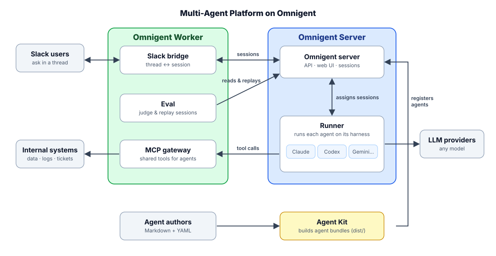
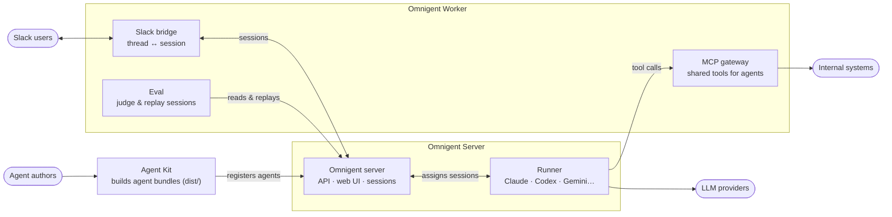
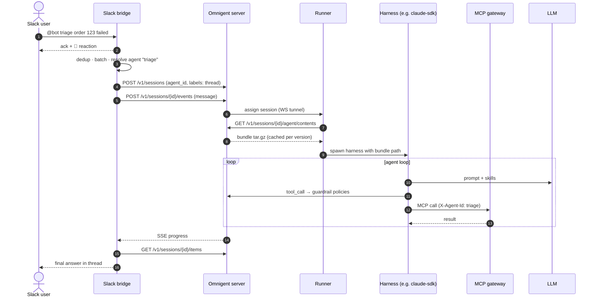

# Building a Multi-Agent Platform on Omnigent — Part 1: Platform Design & Setting Up Omnigent

> **Series**
> 1. **Platform design & setting up Omnigent** ← you are here
> 2. [The Agent Kit: how every team builds agents on one platform](./02-agent-kit.md)
> 3. [The worker: Slack bridge & MCP gateway](./03-slack-bridge-and-mcp-gateway.md)
> 4. [Evals: measuring and gating agent quality](./04-evals.md)

We wanted one place where any engineer — or any team — could ship an AI
agent, pick the model and harness that suits it, give it tools, and put it
in front of colleagues in Slack. Not one bot: a **platform** of agents (a
router, an on-call triage agent, a chart generator, a coding agent…) running
on several model vendors at once.

We built it on [Omnigent](https://github.com/omnigent-ai/omnigent), an
open-source server that runs agents across harnesses (Claude SDK, Codex,
Gemini/Antigravity, Cursor, Copilot, …) behind one API. This series shows how
to rebuild the whole thing from scratch. Part 1 covers the design and getting
the Omnigent server running with your own agents.

---

## 1. Design goals

1. **Multi-agent.** Many independent agents, each with its own prompt,
   skills and tools — plus sub-agents they can delegate to.
2. **Multi-model.** Each agent (and each sub-agent) chooses its own harness
   and model. A router on one vendor can hand a review to a sub-agent on
   another.
3. **Anyone can build an agent.** Authoring an agent should mean writing
   Markdown and YAML, not touching infrastructure.
4. **Agents are stateless code; the platform owns state.** Sessions, history,
   costs and permissions live in Omnigent's Postgres, not in agent code.
5. **Tools are shared infrastructure.** Credentials to internal systems live
   in one MCP gateway, not in every agent.
6. **Measurable.** Every agent's real conversations can be sampled, replayed
   and judged.

## 2. The two halves: server and worker

We split the platform into two deployable units.

| | **Omnigent Server** | **Omnigent Worker** |
|---|---|---|
| Role | *Runs* agents | *Connects* agents to people, tools and quality checks |
| Components | Omnigent server (API, web UI, session store), Postgres, the **runner** that executes agent sessions, the mounted agent bundles | **Slack bridge** (agent gateway), **MCP gateway** (internal tools), **Eval** harness |
| Owns state | Sessions, items, costs, agents, users | Slack thread ↔ session mapping, dedup, feedback (gateway DB); eval results (eval DB) |
| Changes when | A new agent bundle is released | A new surface, tool or eval is added |

The server half is the **agent runtime**: everything needed to execute a
turn. The worker half is everything *around* it: how a message arrives, which
tools the agent can call, and how we know it's doing a good job. Together
they form the platform.

### 2.1 Platform diagram



The same picture as Mermaid (renders on GitHub):



Read it left to right: a Slack message enters through the **Slack bridge**,
becomes a **session** on the Omnigent server, and the **runner** executes the
agent on whichever model its config names. When the agent needs data it
calls tools through the **MCP gateway**. **Eval** watches and replays sessions
from the side, and the **Agent Kit** supplies the agents themselves.

### 2.2 What each piece does

**Omnigent Server**

* **Omnigent server** — the control plane. Exposes the REST/SSE API and web
  UI, stores agents, sessions, conversation items, costs and permissions in
  Postgres, and evaluates guardrail policies on every tool call.
* **Agent bundles** — folders produced by the Agent Kit (Part 2), mounted
  read-only and registered at startup via `OMNIGENT_BUILTIN_AGENT_DIRS`. The
  server tars each one and stores it content-addressed.
* **Runner** — an `omni host` process. It dials *out* to the server over
  a WebSocket tunnel, so it needs no inbound port. On a session's first turn
  it downloads the agent's bundle (`GET /v1/sessions/{id}/agent/contents`),
  caches it per agent version, and spawns the harness subprocess the agent's
  `config.yaml` asks for. Runners need **no** agent-specific bootstrap —
  bundle distribution is built into Omnigent.

**Omnigent Worker**

* **Slack bridge (agent gateway)** — a stateless service that maps a Slack
  thread to an Omnigent session. It acks Slack within 3 s, de-duplicates
  events, batches rapid messages into one turn, maps the Slack user to an
  Omnigent identity, picks which agent to run from a small `registry.yaml`
  (`@bot triage …`, `@bot chart …`, else the channel default, else the
  router), streams live progress, and posts the final answer built from the
  stored session items. It contains **no** prompts or agent logic.
* **MCP gateway** — one HTTP MCP server (`:8931/mcp`) that wraps internal
  systems: warehouse SQL (read-only), logs, APM metrics, ticketing,
  documentation, object storage, a vector-backed memory, and a chart
  renderer. Agents reference it with a single declaration; credentials stay
  here.
* **Eval harness** — runs on a schedule: collects sessions from Omnigent's
  Postgres (read-only), pulls reports/threads via the MCP gateway, runs LLM
  judges calibrated against human labels, and **replays** golden cases
  against a candidate bundle with a mock MCP serving recorded tool responses
  (real model, deterministic tools). Doubles as a pre-release gate.

### 2.3 A request, end to end



### 2.4 Why this split?

* **Blast radius.** The worker holds Slack and internal-system credentials;
  the server holds session data and runs the agent bundles, which carry
  their own model keys. Neither needs the other's
  secrets.
* **Independent scaling.** Add runners for more concurrent sessions; add
  gateway replicas for more Slack traffic. Neither forces the other.
* **Independent release cadence.** Agents change daily (a Kit release +
  server restart). The bridge, MCP gateway and evals change far less often.
* **The grader is not the graded.** Evals run outside the runtime so a bad
  agent release can't take its own quality checks down with it.
* **Surfaces are pluggable.** Slack is just the first surface. A web chat or
  a webhook is another bridge on the worker side; the server doesn't change.

---

## 3. Setting up the Omnigent Server

### 3.1 Prerequisites

* Docker + Docker Compose
* Git
* An LLM credential (a vendor API key, or an internal LLM gateway URL + key).
  It goes into the agent bundles, not the server (see §3.4)
* Python 3.12 (for the Agent Kit build in Part 2)

### 3.2 Clone the repo

```bash
git clone https://github.com/omnigent-ai/omnigent.git
cd omnigent/deploy/docker
```

The stack in `deploy/docker/docker-compose.yaml` is two services:
`postgres` (persistent volume) and `omnigent` (the server image from GHCR,
or built locally from `deploy/docker/Dockerfile`).

### 3.3 Create `.env`

```bash
./bootstrap.sh     # mints POSTGRES_PASSWORD + a cookie secret into .env (idempotent)
```

Or by hand: `cp .env.example .env` and set `POSTGRES_PASSWORD`. Useful
knobs in `.env`:

| Variable | Purpose |
|---|---|
| `POSTGRES_PASSWORD` | Required. |
| `OMNIGENT_PORT` | Host port (default `8000`). |
| `OMNIGENT_IMAGE_TAG` | Pin a `sha-<short>` / `vX.Y.Z` for reproducible deploys. |
| `OMNIGENT_AUTH_ENABLED` | `1` (default) = multi-user auth; `0` = single-user local mode. |
| `OMNIGENT_OIDC_*` | Bring your own IdP for SSO. |
| `OMNIGENT_FEATURES` | Comma-separated release features. |

### 3.4 Add `docker-compose.override.yaml`

**Don't edit `docker-compose.yaml`.** Compose automatically merges a file
called `docker-compose.override.yaml` sitting next to it, so all of your
platform-specific wiring lives in one small file and upstream updates stay a
clean `git pull`.

```yaml
# deploy/docker/docker-compose.override.yaml
services:
  omnigent:
    volumes:
      # 1. Your built agent bundles (Agent Kit output — see Part 2), read-only.
      - /absolute/path/to/agent-kit/dist:/agents:ro
    environment:
      # 2. Register agents: colon-separated in-container paths.
      OMNIGENT_BUILTIN_AGENT_DIRS: /agents/router:/agents/triage:/agents/chart
      # 3. Local development only — every request becomes one "local" user.
      #    NEVER set this on a shared deployment.
      # OMNIGENT_AUTH_ENABLED: "0"
```

What each change does:

1. **Bundle mount.** Paths in `OMNIGENT_BUILTIN_AGENT_DIRS` are resolved
   *inside* the container, so the host `dist/` folder has to be mounted
   first. `:ro` because the server only ever reads it.
2. **Agent registration** — see §3.6.
3. **Auth.** For a laptop, single-user mode avoids a login screen. For
   anything shared, keep auth on and configure accounts or OIDC.

#### Where do models and LLM keys come from?

Not from Omnigent. There is no server-side provider config to edit. Each
agent's own `config.yaml` names its harness, model and LLM credentials in the
`executor` block, and the Agent Kit bakes that into the bundle:

```yaml
# agents/triage/config.yaml (in the Agent Kit)
executor:
  type: omnigent
  model: sonnet
  config:
    harness: claude-sdk
  auth:
    type: api_key
    api_key: ${TRIAGE_LLM_API_KEY}     # placeholder; filled in at build time
    base_url: https://<your-llm-gateway>
```

So the server stays generic: swapping a model, a vendor or a key is a change
in the kit and a rebuild, not a server redeploy. Two consequences:

* Every agent can point at a different model, vendor or gateway, and each can
  have its own key with its own budget and audit trail.
* The built `dist/` folder contains the real key after a local build. Keep
  `dist/` out of git, and mount it read-only (as above). Part 2, §9 covers how
  the substitution works and why CI builds leave the placeholder in place.

### 3.5 Start the server

```bash
docker compose up -d
docker compose logs -f omnigent
```

Open http://localhost:8000. With auth enabled, the first boot asks you to
create an admin (or pre-seed one with `OMNIGENT_ACCOUNTS_INIT_ADMIN_PASSWORD`).

### 3.6 Register your agents

An Omnigent "built-in agent" is any agent listed in
`OMNIGENT_BUILTIN_AGENT_DIRS`. Each entry is either a single spec file
(`/agents/foo.yaml`) or a **bundle directory** (`/agents/triage`); the agent's
name is the file stem or directory name. Built-ins are available to every
user and — importantly for the Slack bridge — are the only agents a service
identity can start sessions on by id. (Agents created ad hoc in the web UI are
scoped to their creator.)

To register a new agent:

1. Build it into `dist/<name>/` (Part 2).
2. Append `/agents/<name>` to `OMNIGENT_BUILTIN_AGENT_DIRS`.
3. Recreate the container. Registration runs **once at startup**; there is
   no live reload.

```bash
docker compose up -d --force-recreate omnigent   # after changing env/mounts
docker compose restart omnigent                  # after only rebuilding dist/
```

Verify:

```bash
docker compose logs omnigent | grep "built-in agent"
# Registered extra built-in agent 'triage' from /agents/triage
curl -s "http://localhost:8000/v1/agents?limit=100" | jq '.data[] | {id, name}'
```

A bad path is logged and **skipped** rather than failing startup, so always
check this log line. Note each agent's `ag_…` id — the Slack bridge's
`registry.yaml` maps friendly names to these ids (Part 3).

### 3.7 Place your agent in the agents folder

The mounted folder must contain one sub-folder per agent, in Omnigent's
bundle shape:

```
dist/
├── router/
│   ├── config.yaml        # name, executor (harness + model), guardrails, sub-agents
│   ├── AGENTS.md          # the system prompt
│   ├── skills/<skill>/SKILL.md
│   ├── tools/mcp/<server>.yaml
│   └── agents/<sub-agent>/config.yaml
├── triage/
└── chart/
```

Two rules Omnigent relies on:

* The **folder name must equal `name:` in its `config.yaml`** — that's how a
  stable built-in agent id is derived.
* Everything the agent needs must be **inside** its folder. The runner only
  receives that folder's tarball.

The smallest possible agent, to prove the pipeline end to end:

```yaml
# dist/hello/config.yaml
spec_version: 1
name: hello
description: Says hello and explains what it can do.
executor:
  type: omnigent
  model: sonnet
  config:
    harness: claude-sdk
instructions: AGENTS.md
```

```markdown
<!-- dist/hello/AGENTS.md -->
You are a friendly test agent. Greet the user, then list the skills you have.
```

You *could* hand-write every agent like this. But once several teams are
shipping agents, you'll want shared skills, one place to declare MCP servers,
marketplace plugins, validation and versioned releases — which is exactly why
`dist/` is generated by an **Agent Kit** rather than written by hand. That's
Part 2.

### 3.8 Start a runner

Sessions execute on a runner. On the server host (or any machine that can
reach it):

```bash
omni login http://localhost:8000   # once, when auth is enabled
omni host --server 'http://localhost:8000'   # new sessions can now run on this machine
```

The runner connects out over a WebSocket and picks up sessions. Install the
CLIs for the harnesses your agents use (for example `claude` for
`claude-native`, `codex` for Codex); SDK harnesses run in-process. The
`deploy/docker/install-harness-cli.sh` script shows how the image installs
them.

---

## 4. Verify it works

1. **Server is healthy:** `curl -s http://localhost:8000/v1/info | jq` returns
   JSON.
2. **Agents registered:** the `Registered extra built-in agent` log line
   appears once per entry in `OMNIGENT_BUILTIN_AGENT_DIRS`, and each agent shows
   up in the web UI's agent picker.
3. **Runner online:** the web UI shows your host as connected.
4. **A real turn:** in the web UI, start a session with `hello`, send
   "hi — what can you do?", and confirm you get a reply that lists its
   skills. Check that the session's cost and model are recorded.
5. **Bad path is skipped:** add `/agents/does-not-exist` to
   `OMNIGENT_BUILTIN_AGENT_DIRS`, recreate, and confirm the server still boots
   and logs a "Failed to register extra built-in agent" warning.
6. **Change propagates:** edit `dist/hello/AGENTS.md` (e.g. "always answer in
   one sentence"), `docker compose restart omnigent`, start a **new** session,
   and confirm the new behaviour.

---

## Troubleshooting

| Symptom | Likely cause |
|---|---|
| Agent missing after restart | Path in `OMNIGENT_BUILTIN_AGENT_DIRS` is the host path, not the in-container path; or the mount is missing. |
| Agent registered but session fails to start | No runner connected, or the harness CLI isn't installed on the runner. |
| `name` mismatch / odd agent id | Folder name ≠ `name:` in `config.yaml`. |
| Edits don't show up | Registration is startup-only — restart, and start a new session. |
| Model auth errors | The bundle still has a literal `${..._LLM_API_KEY}`: the var wasn't set when you ran the kit build. Set it in the kit's `.env`, rebuild, restart. |

---

## What's next

* **Part 2 — The Agent Kit.** Where `dist/` comes from: the registry,
  per-agent manifests and configs, shared skills, declaring MCP servers once,
  reusing marketplace plugins, and the builder that produces validated,
  versioned bundles.
* **Part 3 — The worker.** The Slack bridge and the MCP gateway in detail.
* **Part 4 — Evals.** Judging real sessions, replaying golden cases and
  gating releases.
