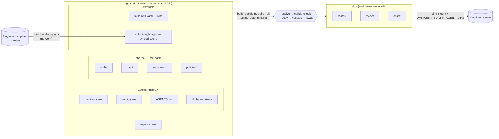
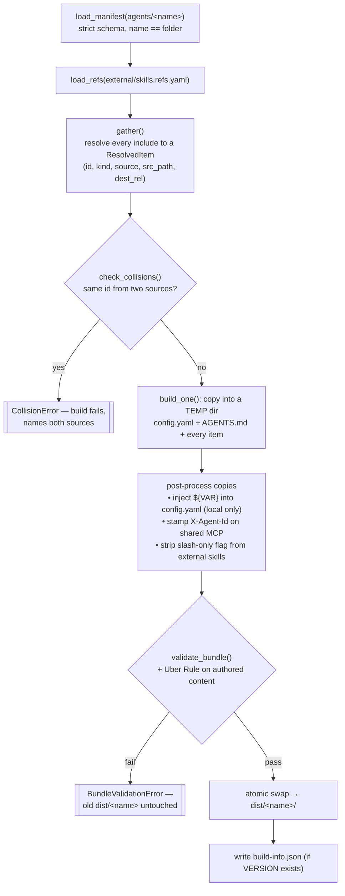

# Building a Multi-Agent Platform on Omnigent — Part 2: The Agent Kit

> **Series**
> 1. [Platform design & setting up Omnigent](./01-platform-design-and-omnigent-setup.md)
> 2. **The Agent Kit: how every team builds agents on one platform** ← you are here
> 3. [The worker: Slack bridge & MCP gateway](./03-slack-bridge-and-mcp-gateway.md)
> 4. [Evals: measuring and gating agent quality](./04-evals.md)

In Part 1 we stood up the Omnigent server and pointed it at a folder called
`dist/`:

```yaml
volumes:
  - /path/to/agent-kit/dist:/agents:ro
environment:
  OMNIGENT_BUILTIN_AGENT_DIRS: /agents/router:/agents/triage:/agents/chart
```

We promised to explain where that folder comes from. This article is that
explanation. `dist/` is the output of a small repository we call the
**Agent Kit**: a source tree, a manifest format, and a ~1,500-line Python
builder that turns "a few Markdown files and a YAML manifest" into a bundle
Omnigent can load.

---

## 1. Why an Agent Kit at all?

Omnigent can load a single agent from a folder like this:

```
my-agent/
├── config.yaml        # executor (harness + model), guardrails, sub-agents
├── AGENTS.md          # the system prompt
├── skills/<name>/SKILL.md
├── tools/mcp/<server>.yaml
└── agents/<sub-agent>/config.yaml
```

For one agent written by one person, you'd just hand-write that folder and be
done. That stops working the moment you want a **platform** — a place where
*anyone in the company* can ship an agent:

| Problem when every team hand-writes bundles | What the Kit does instead |
|---|---|
| The same "how to format a Slack reply" skill is copy-pasted into five agents and drifts. | Write it **once** in `shared/`, reference it by name from each agent. |
| Every agent re-declares the MCP server URL + auth header; one rotates, four break. | Declare each MCP server **once** in `shared/mcp/`; the build copies it into every consumer. |
| Teams want to reuse skills that already exist in your Claude Code plugin marketplace. | **Pin** the plugin by tag; the build fetches it and translates its skills, sub-agents and `.mcp.json` into Omnigent's shape. |
| A skill written as "call the `Bash` tool" only works on one harness. | A validator enforces **harness-neutral** content so the same skill runs on Claude SDK, Codex, Gemini, etc. |
| A typo in a skill name means the skill silently never ships. | The build fails loudly with "did you mean …?" and a per-agent summary of what was pulled in. |
| Someone hot-fixes the running bundle and the fix is lost next deploy. | `dist/` is **build output only** — regenerated atomically from source every time. |

In short: the Kit separates **authoring** (what humans write) from the
**runtime tree** (what Omnigent loads). *Source tree ≠ runtime tree.*



---

## 2. Repository layout

```
agent-kit/
├── registry.yaml              # which top-level agents get built
├── build_bundle.py            # CLI: sync | build <name> | build --all | catalog
├── kit_build/                 # the builder library
│   ├── manifest.py            #   parse + validate manifest.yaml
│   ├── refs.py                #   sync pinned marketplace plugins
│   ├── resolve.py             #   turn includes into concrete files
│   ├── merge.py               #   flatten into dist/<name>/ atomically
│   ├── types.py               #   frozen dataclasses (Manifest, ResolvedItem…)
│   └── errors.py              #   one BuildError subclass per failure mode
├── ci/
│   ├── validate_bundle.py     # structural check of a built bundle
│   └── validate_skills.py     # harness-neutrality, frontmatter, secrets scan
├── agents/                    # one folder per top-level agent
│   ├── router/
│   ├── triage/
│   └── chart/
├── shared/                    # reusable bank
│   ├── skills/<category>/<skill>/SKILL.md
│   ├── mcp/<server>.yaml
│   ├── subagents/<name>/config.yaml
│   └── policies/<name>.py
├── external/
│   ├── skills.refs.yaml       # pin ledger for marketplace plugins
│   └── <plugin>@<ref>/        # synced cache (gitignored)
├── docs/                      # SKILL_TEMPLATE.md, MCP catalog, ADRs …
└── dist/                      # BUILD OUTPUT — gitignored, never edit
```

Only one dependency: `pyyaml`. Everything else is the standard library and
`git`.

---

## 3. The three sources of content

Every piece of content — a skill, an MCP declaration, a sub-agent, a policy —
lives in exactly **one** of three places. The category describes *where it's
owned*, never *who uses it*; usage is decided per agent by its manifest.

| Source | Lives in | Use it when |
|---|---|---|
| **external** | A plugin marketplace repo, pinned in `external/skills.refs.yaml` | The skill's real home is your Claude Code plugin marketplace and you just want this agent to include it. |
| **shared** | `shared/{skills,mcp,subagents,policies}/` | Reusable by more than one agent — general capabilities *and* a business vertical's reference knowledge (rules, event taxonomy, warehouse schema, playbooks). |
| **private** | `agents/<name>/skills/` | Only ever used by one agent (its defining procedure). |

> **When unsure, default to `shared`.** Moving a shared item into one agent
> later is easy. Un-sharing something another agent already depends on is the
> move that breaks things.

---

## 4. The registry

`registry.yaml` is the list of top-level agents the build produces. It is
deliberately boring:

```yaml
# registry.yaml
agents:
  - router     # the default entry agent
  - triage     # on-call triage
  - chart      # turns user data into a chart image
```

Why a separate file instead of "build every folder under `agents/`"?

* **Explicit release surface.** `build --all` and the release pipeline build
  exactly this list. A half-written agent folder can sit on a branch without
  shipping.
* **One canonical name per bundle.** Aliases and synonyms ("coder",
  "builder", "engineer" → `code`) are a *routing* concern and live on the
  Slack-gateway side (Part 3), not here.
* **Name = folder = `config.yaml` name.** Omnigent derives a stable built-in
  agent id from the bundle directory name, so the builder enforces that the
  registry entry, the folder, the manifest `name:` and the `config.yaml`
  `name:` are all identical.

---

## 5. Anatomy of one agent's source

Each `agents/<name>/` has three required files (plus optional private
skills and a `VERSION`).

### 5.1 `manifest.yaml` — *what this agent pulls in*

The manifest is the Kit's own format. It never reaches Omnigent; it only
tells the builder what to include.

```yaml
# agents/triage/manifest.yaml
name: triage                       # must equal the folder name
includes:
  external: [code-search]          # a pinned marketplace plugin (all its skills,
                                   # sub-agents and MCP servers come along)
  private:
    skills: [on-call-triage, on-call-report, on-call-playbooks]
  shared:
    skills: [orders, payments, metrics-taxonomy, slack-response-format]
    mcp: [internal-mcp]            # → tools/mcp/internal-mcp.yaml
    subagents: []                  # → agents/<name>/config.yaml
    policies: []                   # → policies/<name>.py
    subagent_mcp:                  # grant a shared MCP to ONE sub-agent
      code-explorer: [internal-mcp]
```

The schema is intentionally tiny and strictly validated
(`kit_build/manifest.py`): unknown keys at any level are a hard error, so a
typo like `include:` or `shared.skill:` can't silently do nothing.

```python
_TOP_LEVEL_KEYS = {"name", "includes"}
_INCLUDES_KEYS  = {"external", "shared", "private"}
_SHARED_KEYS    = {"skills", "mcp", "subagents", "policies", "subagent_mcp"}
_PRIVATE_KEYS   = {"skills"}
```

### 5.2 `config.yaml` — *the Omnigent agent spec*

This is copied into the bundle verbatim (after env substitution, see §8). It
is the **only** place a harness or model name may appear.

```yaml
# agents/chart/config.yaml
spec_version: 1
name: chart                         # must equal the bundle folder name
description: >-
  Generates one chart image (PNG) from data the user provides. Asks for
  every missing input before rendering; never invents or fetches data.

# ── EXECUTOR: the only harness-specific block ("wiring layer") ──
executor:
  type: omnigent
  context_window: 1000000
  model: sonnet
  config:
    harness: claude-sdk
  auth:                             # model credentials live here, not on the server
    type: api_key
    api_key: ${CHART_LLM_API_KEY}   # placeholder only — never a literal
    base_url: https://<your-llm-gateway>

instructions: AGENTS.md

async: true
cancellable: true
timers: true

os_env:
  type: caller_process
  cwd: .
  sandbox:
    type: none

# Least privilege, enforced by policy rather than by prompt.
guardrails:
  policies:
    chart_tools_only:
      type: function
      function:
        path: omnigent.policies.builtins.cel.cel_policy
        arguments:
          expression: >-
            event.type == "tool_call" &&
            event.data.name.matches("(?i)^mcp__") &&
            !event.data.name.matches("(?i)^mcp__.*__chart_(render|list_types)$")
            ? {"result": "DENY", "reason": "Only the chart tools are allowed."}
            : {}
```

Because model, harness and LLM credentials live here and *only* here, moving
an agent from `claude-sdk` to `codex` — or splitting a router on one vendor
and a reviewer sub-agent on another — is a one-block change. That's the
"multi-model" half of the platform. The Omnigent server has no provider
config of its own; it runs each bundle with the `auth` the bundle carries.
Each agent gets its own `<AGENT>_LLM_API_KEY`, so keys can be rotated,
budgeted and audited per agent.

### 5.3 `AGENTS.md` — *the system prompt*

Plain Markdown, harness-neutral. It describes the agent's job, when to load
which skill, and the output contract. It refers to tools **by capability**
("query the warehouse (read-only)"), never by a vendor tool name.

### 5.4 Private skills and `VERSION`

`agents/<name>/skills/<skill>/SKILL.md` holds procedures only this agent uses.
An optional `VERSION` file (`1.MAJOR.MINOR`) gets stamped into the bundle as
`build-info.json`, so the running server can tell you exactly what it loaded:

```json
{
  "agent": "triage",
  "version": "1.0.2",
  "label": "1.0.2+2a052d5.dirty",
  "git_sha": "2a052d59…",
  "dirty": true,
  "tag": "triage-v1.0.2",
  "built_at": "2026-11-17T07:12:01+00:00"
}
```

---

## 6. Writing a skill

Skills are the unit of contribution — "anyone can add a capability by adding
one Markdown file." The Kit ships a template:

```markdown
---
name: verb-noun                 # MUST equal the directory name
description: One specific line describing exactly when to load this skill.
category: engineering           # just a folder; doesn't affect routing
required_mcps: [warehouse]      # capabilities, not vendor tools
version: "1.0"
---

# verb-noun — one-line purpose

Use this skill when <the precise trigger>.

## Procedure
1. **Gather** — "Query the warehouse (read-only) for <metric> over <window>."
2. **Correlate** — what to do with what you gathered.
3. **Report** — the exact shape of the final answer.

## Notes
- Reference tools by capability only (no vendor tool names).
- Mask secrets/PII.
- If a capability is unavailable, say so and do what you can.
```

The ritual for adding one:

1. Copy the template into `shared/skills/<category>/<verb-noun>/SKILL.md`
   (or `agents/<name>/skills/<verb-noun>/` if private).
2. Write the procedure by **capability**.
3. **Register it in the consuming agent's `manifest.yaml`.** A skill on disk
   that no manifest names is invisible to the build — this is the most common
   mistake, which is why the build prints a summary
   (`[24 skills, 2 MCP servers, 1 subagent, 0 policies]`) you can eyeball.
4. Build and validate locally (§9).

### The "Uber Rule": harness-neutral content

> Nothing in the *content* of the Kit may be specific to one agent harness.

A skill must behave the same whether the runner is Claude SDK, Codex,
Gemini/Antigravity, or anything else Omnigent adds. So `validate_skills.py`
rejects vendor tool and harness names (`Bash`, `Write`, `mcp__…`,
`claude-sdk`, …) anywhere **except** the `executor:` block of a
`config.yaml`. Omnigent's own policies follow the same idea — a shell call is
matched as the union `{"sys_os_shell", "Bash", "bash"}` — so writing to
capabilities is what makes one skill bank serve many models.

Skills pulled from an external plugin are exempt (you don't own them and must
not edit them); your authored skills and prompts are always checked.

---

## 7. MCP: declare once, use everywhere

### 7.1 Where MCP declarations come from

| Where the MCP server comes from | Where you declare it |
|---|---|
| A marketplace plugin ships its own `.mcp.json` | **Nowhere** — `sync` auto-translates it with the plugin pin. |
| A third-party vendor has an official MCP (Slack, Jira, analytics…) | `shared/mcp/<vendor>.yaml`, pointing at the vendor endpoint. |
| A bespoke internal API with no off-the-shelf MCP | `shared/mcp/<name>.yaml`, pointing at your own **MCP gateway** (Part 3). |

### 7.2 The declaration file

```yaml
# shared/mcp/internal-mcp.yaml — one file per MCP server
name: internal-mcp                # MUST match the filename stem
transport: http                   # remote HTTP only for always-on agents
url: http://<mcp-gateway-host>:8931/mcp
headers:
  Authorization: "Bearer ${INTERNAL_MCP_TOKEN}"   # placeholder, never a literal
```

```yaml
# shared/mcp/analytics.yaml — a vendor MCP consumed directly
name: analytics
transport: http
url: https://mcp.<analytics-vendor>.com/mcp
headers:
  Authorization: "Bearer ${ANALYTICS_SERVICE_TOKEN}"
```

Rules worth adopting:

1. **One file per MCP**, named after the vendor (single-vendor server) or the
   capability (swappable backend).
2. **No literal secrets.** `${ENV_VAR}` placeholders are resolved by Omnigent
   at load time from the *runner's* environment; a missing var fails loudly.
3. **Remote HTTP only** for agents that run unattended — a stdio server would
   need a runtime installed on every runner host.
4. **Least privilege lives in credentials and policies.** Mint read-only
   tokens for read-only agents, and use a `guardrails` policy (like the chart
   example) to allow-list tools. A per-tool `tools:` list in a sidecar MCP file
   is *not* enforced by Omnigent — only an inline `config.yaml` declaration
   honours it.
5. **Check tool-name parity** before wiring a vendor MCP into an existing
   skill — the names your skill calls must exist on the server.

### 7.3 Adding an MCP to an agent

```yaml
# agents/chart/manifest.yaml
name: chart
includes:
  shared:
    skills: [slack-response-format]
    mcp: [internal-mcp]           # lands at dist/chart/tools/mcp/internal-mcp.yaml
```

Need it on a **sub-agent** instead? Omnigent resolves MCP *per agent
directory*, so a sub-agent nested in a bundle does **not** inherit the root's
`tools/mcp/`. Use `subagent_mcp`:

```yaml
includes:
  shared:
    subagent_mcp:
      code-explorer: [internal-mcp]   # → agents/code-explorer/tools/mcp/internal-mcp.yaml
```

### 7.4 Per-agent identity, for free

When the builder copies a shared HTTP MCP declaration it stamps an
`X-Agent-Id` header naming the agent that will use it:

```yaml
# dist/chart/tools/mcp/internal-mcp.yaml (generated)
# Stamped per agent by kit_build.merge (X-Agent-Id); source: shared/mcp/.
name: internal-mcp
transport: http
url: http://<mcp-gateway-host>:8931/mcp
headers:
  X-Agent-Id: chart
```

Your MCP gateway can now log, rate-limit and authorize *per agent* without any
agent author doing anything. (It's static per agent, which is safe with
Omnigent's pooled connections because headers are part of the pool key.)

---

## 8. External plugins: reuse your Claude Code marketplace

Many teams already have a Claude Code plugin marketplace. The Kit lets an
Omnigent agent consume those plugins without copy-pasting.

```yaml
# external/skills.refs.yaml — ONE entry per plugin, not per skill
skills:
  - name: code-search
    source:
      repo: your-org/knowledgebase
      path: plugins/code-search        # plugin ROOT
      ref: code-search-v1.1.1          # tag or 40-hex SHA = cached & reproducible
    # skills: [find, explore]          # optional filter; omit = everything

  - name: sdd
    source:
      repo: your-org/sdd-plugin
      path: plugin
      ref: sdd-v4.3.1
    skills: [spec-init, spec-design, spec-tasks, impl, verify-completion]
    subagents: [implementer]           # optional filter on agents/*.md stems
```

`python build_bundle.py sync` (the **only** command that touches the network):

1. Clones each pin into `external/<name>@<ref>/`. Tags and SHAs are cached;
   a branch ref is re-fetched every sync (allowed, but trades reproducibility
   for freshness).
2. Auto-discovers the plugin's `.mcp.json` and translates every server into a
   `tools/mcp/<server>.yaml` file.
3. Auto-discovers the plugin's `agents/*.md` (Claude Code sub-agent files) and
   translates each into an Omnigent `agents/<name>/config.yaml`:

```yaml
# AUTO-GENERATED by `build_bundle sync` — do NOT hand-edit.
spec_version: 1
name: code-explorer
description: Searches internal codebases and returns answers with file paths…
executor:
  type: omnigent
  config:
    harness: claude-sdk
    model: sonnet
prompt: |
  <role>You are a codebase explorer …</role>
```

In the manifest you reference the **plugin**, not individual skills:
`includes.external: [code-search]`. To make the translated sub-agent
dispatchable, also list it in the agent's `config.yaml`:

```yaml
tools:
  agents:
    - code-explorer
```

---

## 9. How `dist/` is generated

```bash
python -m venv .venv && source .venv/bin/activate
pip install pyyaml

python build_bundle.py catalog        # list every name you can reference
python build_bundle.py sync           # fetch pinned plugins (network)
python build_bundle.py build --all    # build every agent in registry.yaml (offline)
python ci/validate_skills.py          # whole-repo neutrality / frontmatter / secrets scan
```

Typical output:

```
Built router -> dist/router  [12 skills, 2 MCP servers, 1 subagent, 0 policies]
Built triage -> dist/triage  [24 skills, 2 MCP servers, 1 subagent, 0 policies]  version 1.0.2+2a052d5
Built chart  -> dist/chart   [1 skill, 1 MCP server, 0 subagents, 0 policies]
```

### 9.1 The pipeline, step by step



**Resolution** maps every include kind to a fixed destination:

| Include | Source | Lands at |
|---|---|---|
| `shared.skills: [x]` | `shared/skills/**/x/` | `skills/x/` |
| `private.skills: [x]` | `agents/<name>/skills/x/` | `skills/x/` |
| `shared.mcp: [x]` | `shared/mcp/x.yaml` | `tools/mcp/x.yaml` |
| `shared.subagents: [x]` | `shared/subagents/x/` | `agents/x/` |
| `shared.subagent_mcp: {s: [x]}` | `shared/mcp/x.yaml` | `agents/s/tools/mcp/x.yaml` |
| `shared.policies: [x]` | `shared/policies/x.py` (+ package) | `policies/x.py` |
| `external: [p]` | `external/p@ref/…` | `skills/*`, `tools/mcp/*`, `agents/*` |

**Collisions are fatal.** If a shared skill and a plugin skill share an id,
the build stops and names both. There is no precedence order to memorize.

**Validation mirrors Omnigent's load contract** (`ci/validate_bundle.py`):
only `config.yaml`, `AGENTS.md`, `skills/`, `tools/`, `agents/`, `policies/`
at the top level; folder name equals `config.yaml` name; every `SKILL.md` has
parseable frontmatter whose `name` equals its directory; no file resolves
outside the bundle. If Omnigent itself is importable, it additionally runs
Omnigent's own built-in loader against the bundle.

**Atomic swap.** Everything is assembled and validated in a temp directory
inside `dist/`; only on success is the old `dist/<name>/` moved aside and the
new one moved in. A broken build never leaves a half-written bundle for the
server to pick up.

**Secrets.** Source `config.yaml` only ever contains `${VAR}`. For local
builds the builder substitutes from the process env / a gitignored `.env`;
in CI the var is unset, so the placeholder stays and nothing is embedded.

### 9.2 What you get

```
dist/triage/
├── build-info.json
├── config.yaml                       # executor, guardrails, tools.agents
├── AGENTS.md                         # system prompt
├── skills/
│   ├── on-call-triage/SKILL.md       # private
│   ├── orders/SKILL.md + references/ # shared vertical corpus
│   ├── slack-response-format/SKILL.md
│   └── find/ explore/ callers/ …     # from the code-search plugin
├── tools/mcp/
│   ├── internal-mcp.yaml             # shared, stamped X-Agent-Id: triage
│   └── code-search-mcp.yaml          # translated from the plugin's .mcp.json
└── agents/
    └── code-explorer/
        ├── config.yaml               # translated from the plugin's agents/*.md
        └── tools/mcp/…
```

That folder is exactly what Part 1 mounted into the Omnigent container.

---

## 10. What is reusable (and what isn't)

| Asset | Reuse scope | How it's shared |
|---|---|---|
| Skills (`shared/skills/`) | Any agent | `includes.shared.skills` |
| Vertical knowledge (rules, taxonomy, schemas, playbooks) | Any agent touching that vertical | A shared skill folder per vertical with `references/` |
| MCP declarations (`shared/mcp/`) | Any agent or sub-agent | `includes.shared.mcp` / `subagent_mcp` |
| Sub-agent workers (`shared/subagents/`) — e.g. a prosecutor/defense/judge/fixer review tribunal | Any agent | `includes.shared.subagents` + `tools.agents` |
| Guardrail policies (`shared/policies/`) | Any agent | `includes.shared.policies` |
| Marketplace plugins | Any agent, any team | One pin in `skills.refs.yaml`, `includes.external` |
| Output-format skills (e.g. Slack formatting) | Every Slack-facing agent | Shared skill, loaded as the final step |
| The builder, validators, CI and release workflow | Every agent | Inherited by being in the repo |
| `config.yaml` executor block | **Per agent** | Deliberately not shared — it's the swappable wiring |
| `AGENTS.md` prompt and private skills | **Per agent** | The agent's identity |

A useful heuristic we landed on: **one decision reused by two skills is its
own skill.** When a skill grows past ~10 KB or two skills start re-explaining
the same procedure, split the shared part out.

---

## 11. Adding a new top-level agent — checklist

1. `mkdir agents/<name>` with `manifest.yaml`, `config.yaml`, `AGENTS.md`.
2. `manifest.yaml` → `name: <name>` (= folder name). List includes.
3. `config.yaml` → `name: <name>`, pick harness + model in `executor:`.
4. Add `<name>` to `registry.yaml`.
5. `python build_bundle.py build <name>` → check the summary line.
6. Add `/agents/<name>` to `OMNIGENT_BUILTIN_AGENT_DIRS` in your
   `docker-compose.override.yaml` and `docker compose up -d --force-recreate omnigent`.

## 12. CI and releases

* **CI on every push/PR:** install `pyyaml pytest` → `pytest tests/` →
  `sync` (using a read-only org token to clone private plugin repos) →
  `build --all` → `validate_skills.py`. The same three commands you ran
  locally.
* **Release on merge to `main`:** rebuild, tar each `dist/<agent>/`, and
  publish a GitHub Release tagged `vYYYY.MM.DD.NNNNN` (orderable, unlike a
  SHA).
* **Deploying a release is a separate, deliberate step.** CI never touches a
  live server; an operator pulls the tarball onto the server host, updates
  the mount, and recreates the container (Omnigent seeds built-in agents at
  startup only).

---

## Try it yourself

1. Build all agents and confirm the summary line for each:
   ```bash
   python build_bundle.py sync && python build_bundle.py build --all
   ```
2. **Prove the "forgot the manifest" guard:** create
   `shared/skills/demo/hello-world/SKILL.md`, rebuild, and confirm the skill
   count for your agent does *not* change. Add `hello-world` to its manifest,
   rebuild, and confirm it goes up by one and `dist/<agent>/skills/hello-world/`
   exists.
3. **Prove typo protection:** reference `hello-wrold` in a manifest — the
   build should fail with a `BuildError` and suggest the correct name.
4. **Prove harness neutrality:** write "run the `Bash` tool" in your skill
   and run `python ci/validate_skills.py` — it should fail.
5. **Prove atomic builds:** break a skill's frontmatter, rebuild, and confirm
   the previous `dist/<agent>/` is unchanged.
6. Restart Omnigent (`docker compose restart omnigent`), open
   http://localhost:8000, and check the new skill is visible on the agent.

In **Part 3** we move to the worker side: the Slack bridge that turns a
thread into an Omnigent session, and the MCP gateway behind `internal-mcp`.
**Part 4** covers the eval harness that keeps all of this honest.
