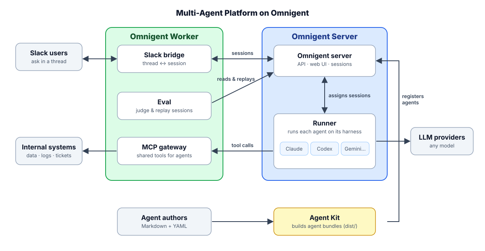
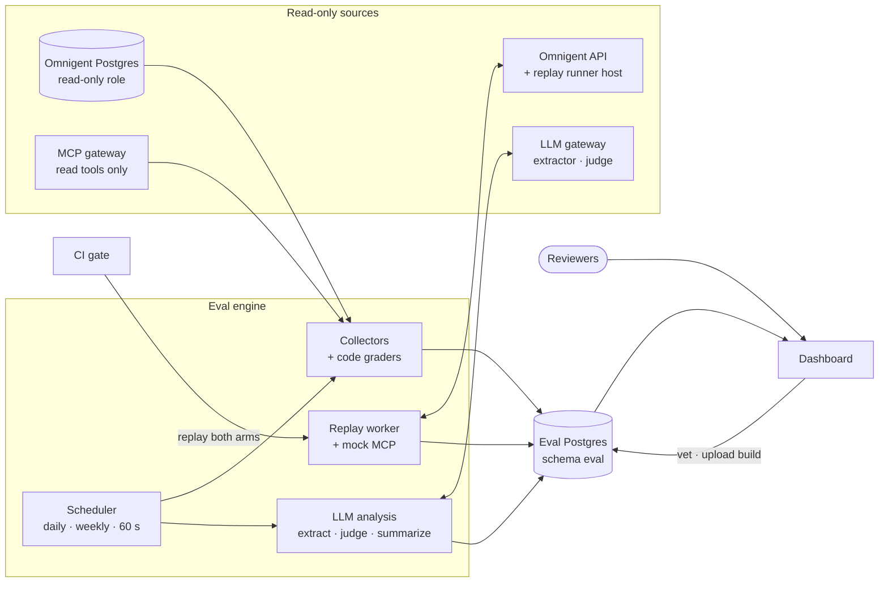
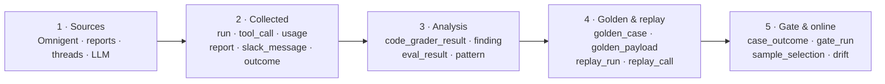
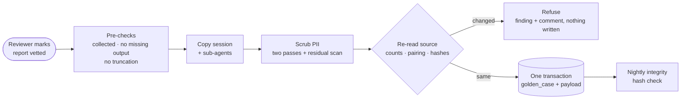
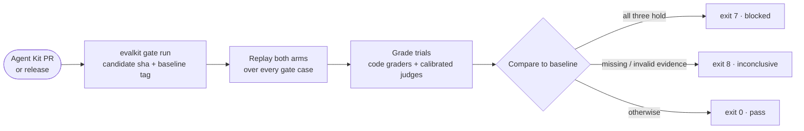

# Building a Multi-Agent Platform on Omnigent — Part 4: Evals

> **Series**
> 1. [Platform design & setting up Omnigent](./01-platform-design-and-omnigent-setup.md)
> 2. [The Agent Kit: how every team builds agents on one platform](./02-agent-kit.md)
> 3. [The worker: Slack bridge & MCP gateway](./03-slack-bridge-and-mcp-gateway.md)
> 4. **Evals: measuring and gating agent quality** ← you are here

By the end of Part 3, people could ask agents questions in Slack and the agents
could reach real data. That's when the uncomfortable question arrives: **is the
new build better or worse than the last one?**

Our reference agent is an on-call **triage** agent. It investigates a support
escalation raised in Slack: it queries the warehouse and analytics, reads logs
and code, and publishes a report with a verdict (Frontend, Backend, Supplier,
Product gap or Customer). Engineers act on that verdict, so a confident wrong
answer costs real time.

When we started we had:

* no regression gate (a prompt change shipped with zero automated checks),
* no golden dataset,
* no replay (re-testing meant running live: real APIs, real tokens,
  non-deterministic results),
* no scoring (we eyeballed traces).

This part describes the eval engine we built to fix that: the data pipeline,
the first metrics, the golden set, how a golden case is scored, and the release
gate.

---

## 1. Where evals sit in the platform



The eval engine is the third service on the **worker** side. It is deliberately
**outside** the agent runtime:



---

## 2. Design choices that shaped everything

**The grader lives outside the agent.** The engine is a separate process with
its own Postgres (database `agent_eval`, schema `eval`). It shares no prompt,
model or credentials with the agent it grades, so a broken agent release can't
take its own quality checks down with it. It only **reads**: Omnigent's
database through a read-only role, and Slack/Confluence through an allow-list of
read-only MCP tools.

**No cross-database SQL.** Every Omnigent read goes through a `SessionSource`
port in Python, keyed by session id. If Omnigent changes its schema, one
adapter changes.

**Error analysis before evaluators.** We started with no ground truth. So the
first evaluators needed no reference answer: tool failures, report structure,
and rubric-based judges. Human review then produces ground truth as a by-product,
and that becomes the golden set.

**Store pointers, not payloads.** Tool outputs can hold customer data. For
ordinary runs we keep ids, hashes, counts and flags. Free text passes through
one function that scrubs PII and **fails closed**: if the scrubbing key is
missing, the text is withheld, never written raw. Only golden cases carry full
payloads, and only after a scrub.

**Idempotent, resumable jobs.** Each job has a watermark, uses
`on conflict do nothing`, and writes only changed rows. Re-running a day writes
zero rows.

**LLM only where code can't decide.** Deterministic graders run first; judges
only handle what's subjective. Dashboard numbers come from SQL, never from an
LLM.

**Least-privilege database roles.**

| Role | Used by | Rights |
|---|---|---|
| `eval_owner` | migrations only | owns the schema |
| `eval_writer` | scheduler jobs | write eval tables |
| `eval_reader` | read-only apps | select |
| `eval_dashboard` | dashboard | select, plus insert into three tables (summaries, golden candidates, evaluate requests) |
| `eval_ro` | on **Omnigent's** Postgres | read-only, short statement timeout |

---

## 3. The pipeline

One in-process scheduler (`evalkit schedule serve`, APScheduler) runs each job
for every `agents/*.eval.yaml` config. A failing job never stops the next one;
the run is marked `partial` and Slack is alerted. Run exactly one scheduler.

| When | Job | What it does |
|---|---|---|
| Daily 01:00 | `sync_agents` | Records which bundle version ran when (Omnigent keeps no history) |
| | `collect_sessions` | One `run` row per session, root and sub-agents |
| | `collect_tool_calls` | Pairs each call with its output; classifies success or failure |
| | `collect_usage` | Cost, tokens and latency per root session |
| | `collect_reports` | Reads published reports and links each to the run that wrote it |
| | `collect_threads` | Reads the Slack thread: agent answer, human replies, reactions |
| | `grade_code` | Deterministic checks per settled session |
| | `extract_findings` | LLM turns reports, threads and sessions into categorised findings |
| | `judge` | Rubric judges: report quality, agent vs human, Q&A answer |
| | `summarize` | 7-day and 30-day summaries for the dashboard |
| | `promote_golden` | Vetted reports become golden cases |
| | `golden_integrity` | Re-checks golden hashes against the source |
| Sunday 00:00 | `cluster_patterns` | Weekly clusters of recurring findings, with trend |
| Every 60 s | `evaluate poll` | Runs build uploads queued from the dashboard |

Data moves through five stages:



Three join keys hold it together: the Omnigent **session id** ties sessions,
tool calls and usage; the **Slack thread** (channel + parent `ts`) ties a run to
its report, messages and outcome; and a **`request_key`** ties a recorded tool
call to its replayed counterpart.

### Two details that took a while to get right

**Pairing tool calls.** Omnigent stores a call and its output as separate items
and **reuses `call_id`** within a session, so `call_id` isn't a key. We pair the
n-th call with the n-th output for the same id, only when the output comes
later. We also found the host mirrors each real call as a second call/output
pair with a wrapped result. One rule drops the mirror everywhere, so recorded
and replayed counts agree.

**Detecting failures.** Omnigent stores no `is_error`. A call is a `failure` when
its output starts with `Error:`, `partial` when it hit the 1 MiB output cap, and
`no_output` when it never got a reply. This misses tools that return error text
without the prefix, which is why we spot-check by hand. (It's also a good reason
to make your MCP gateway return errors in one consistent shape; see Part 3.)

---

## 4. The first metrics

The dashboard reads only `eval` tables, through select-only queries cached for
60 seconds. The LLM only writes prose summaries, and a summary is rejected if it
contains a number that wasn't in its input.

Definitions we settled on:

* **Ticket:** a root session. Sub-agents are children; replay sessions are
  excluded.
* **Resolved:** the agent posted a report, its link is in the Slack thread, and no
  human corrected it.
* **Time to resolution:** from the Slack thread root (the alert) to the report's
  creation time. Our first version measured from session start and was always
  empty; fixing the start point fixed the metric.
* **Human correction rate:** share of threads where a human corrected or
  contradicted the agent.
* **Tool success rate**, **duplicate calls** (same tool and argument hash in one
  session), and **cost per ticket** against a target, with a red line that flags
  a probable polling loop.
* **Judge pass rate** per criterion.

A figure with no data shows `n/a` with the reason, never zero.

**Findings.** Reports and threads are also mined into categorised findings:
agent gap, skill gap, system gap (product), telemetry gap (code) and playbook
change. Each keeps evidence pointers and a dedupe key. A weekly job clusters
them into recurring patterns with a trend, and alerts when "other" grows past
25%.

---

## 5. Graders

### 5.1 Code graders (deterministic, free, consistent)

| Grader | Catches |
|---|---|
| `marker_once_and_last` | Final-answer marker missing, repeated or not last |
| `no_pre_summary_text` | Narration posted before the answer |
| `sections_present` | Missing required report sections |
| `no_calls_after_summary` | Agent keeps working after concluding |
| `no_slack_writes` | Agent writing to Slack directly |
| `slack_thread_id_on_every_call` | Tool calls missing thread correlation |
| `retry_loops` | 3+ consecutive identical tool calls |
| `select_only_sql` | Non-read-only SQL, parsed with `sqlglot`, so a `DELETE` hidden in a CTE still fails |

If a grader lacks the facts it needs (say `sections_present` on a run with no
linked report), it returns **not computable**. That's skipped and counted,
never stored as a pass or a fail.

### 5.2 LLM judges (trusted only after calibration)

Production judges: `verdict_supported`, `rca_groundedness`,
`confidence_calibration`, `actions_actionable`. The rules:

* **Binary per criterion**, reasoning **before** the verdict.
* **`unknown` abstains** rather than scoring.
* The judge runs on a **stronger model tier** than the agent. When both are on the
  top tier we record an explicit `same_tier` exception rather than hide it.
* A judge **gates** anything only after it reaches TPR and TNR ≥ 0.80 on a
  held-out set (≥ 8 subjects per class), with Wilson lower bounds ≥ 0.60. That
  takes roughly 30–50 human labels per judge.
* Changing a judge's rubric or model **clears** its calibration. Figures that
  rest on an uncalibrated judge are labelled "judge not calibrated".
* Prompts and rubrics are **pinned by SHA-256**, with a test that fails if the
  content changes without a version bump. Results store the judge version, so a
  change can be re-run and compared.

---

## 6. The golden set

A **golden case** is a full, PII-scrubbed copy of a vetted production session:
every message, every tool call with its exact arguments and response, the
bundle, and the tool catalogue. It must survive Omnigent's retention and not
depend on live rows.

### 6.1 Promotion



Each recorded call gets a **`request_key`**: SHA-256 of the tool name and
normalised arguments (JSON parsed, keys sorted, timestamps bucketed). Calls with
the same key get an `occurrence` number, so a repeated query returns the
recorded responses in recorded order. The **same function** runs at promotion and
inside the replay mock, so they can't disagree.

### 6.2 Replay

The core insight: to judge a prompt change you must run the new agent against the
**same tool responses**, so you isolate prompt quality from tool variability.

1. **Rewrite the bundle.** Every MCP URL in `tools/mcp/` points at a mock server
   for this run; credentials are stripped; a CEL deny policy blocks shell, file
   and connector tools. The archive is deterministic, so its SHA is stable.
2. **Create a session** on a replay runner host with the **real model**, and send
   the recorded first message once.
3. **The mock answers each tool call:** exact `request_key` match in recorded
   order, else a fuzzy match on arguments, else flagged unmatched. Write tools
   get a canned success and are recorded.
4. **Wait until idle**: two idle polls with no busy child, 900 s per case.
5. **Score** the trial (below), then **delete** the session and its workspace.

This is where the Agent Kit design from Part 2 pays off: because every MCP server
is a separate `tools/mcp/<name>.yaml` file, redirecting all tools to the mock is
a mechanical rewrite of a built `dist/<agent>/` folder.

---

## 7. How a golden case is scored: three graders, one rule

**Grader 1: code graders** (§5.1), run on the replayed session.

**Grader 2: replay judges.** `replay_output` is reference-free.
`replay_reference` is the only judge that sees an expected answer, and runs only
when the case has one.

**Grader 3: trajectory similarity.** How close was the candidate's tool path to
the recorded one, over root-session calls only:

```
order_score      = 2 * LCS(tool names) / (|recorded| + |replayed|)
key_score        = 2 * |multiset of request keys in common| / (|recorded| + |replayed|)
trajectory_score = round((order_score + key_score) / 2, 3)
```

Order catches a different sequence of tools; key catches the same tools with
different arguments. An agent can legitimately take a different but valid path,
so trajectory counts only when an agent's rule names it. Passing trials that
deviated from the recorded path are counted separately as `alt_path`.

### The scoring rule

Each agent declares one rule in its `eval.yaml`:

| Mode | Rule | Use it for |
|---|---|---|
| `binary` | Every `must_pass` grader passes | Strict agents (our triage default) |
| `weighted` | Weighted share of passing graders ≥ `threshold` | Graded quality where no single check is fatal |
| `hybrid` | Threshold **and** every `must_pass` grader | Hard safety checks plus a soft quality score |

Edge cases are decided in one pure function:

* `unknown` is never a pass.
* If a must-pass grader couldn't be computed, the trial is **invalid**, not
  failed, and is excluded with a reason.
* In weighted and hybrid modes, an uncomputable grader is dropped and the
  remaining weights are renormalised.

### From trials to a case

The model is real and nondeterministic, so each case runs several times (3
candidate repeats for a release, 1 for a pull request). Over valid trials only:

* **pass@k:** at least one trial passed.
* **pass^k:** every trial passed. **This is the gated metric.** An on-call agent
  that sometimes fails isn't reliable.
* Cases whose trials disagree are listed as flaky.

### Protecting the signal

* If more than **20%** of a batch fails with one infrastructure error class, the
  batch is **inconclusive**, not an agent failure.
* **Case health** flags cases that are suspect-unsolvable (failing in 3+ trials)
  or saturated (passing for 3 evaluations, so they test nothing). Both are
  excluded from the gate set.
* A reviewer can attribute a failure to the **agent**, the **grader** or the
  **task**. A grader blamed for more than 25% of reviewed failures goes under
  review.

---

## 8. The release gate



The gate runs **baseline and candidate on the same cases** and blocks only when
**all three** hold:

1. the candidate is on the wrong side of the configured absolute threshold,
2. it's worse than baseline by more than the noise allowance (baseline spread
   combined with judge disagreement), and
3. the difference is significant at a one-sided 95% level.

Equal or better never blocks. Missing or invalid evidence returns
**inconclusive** (exit 8), never a pass. Each decision is stored immutably.

The dashboard's **Evaluate** page runs the same replay for a build someone
uploads (a `dist/<agent>/` folder, zip or tarball, with a version strictly higher
than every stored one), and shows per-case score, calls, verdict, cost and
latency deltas against the previous build.

---

## 9. Setting it up

### 9.1 Describe your agent: `agents/<name>.eval.yaml`

All per-agent behaviour lives in one config. The engine has no agent names in
code; a scanner fails the build if one sneaks in.

```yaml
# agents/triage.eval.yaml
agent_id: triage
sources:
  omnigent:
    agent_name: triage                     # the built-in agent name (Part 1)
  slack:
    final_message_marker: "<<final>>"      # same marker the bridge uses (Part 3)
    agent_user_ids: [U0XXXXXXXXX]          # the bot's Slack user id
  confluence:
    space: KB
    report_label: triage-report
    review_labels: [eval:reviewed, eval:golden-candidate, eval:golden, eval:reject]

output_contract:
  single_final_message: true
  required_sections: [Incident Summary, Execution Audit Trail, Human Q&A Log,
                      Retrospective, Telemetry, Self-improvement actions]
  verdict_classes: [Frontend, Backend, Supplier, Product gap, Customer]

evaluators:
  universal: [tool_error_rate, retry_loops, cost_latency_outliers, groundedness]
  code: [marker_once_and_last, no_pre_summary_text, sections_present, no_slack_writes,
         slack_thread_id_on_every_call, select_only_sql, no_calls_after_summary]
  judges: [rca_groundedness, verdict_supported, confidence_calibration, actions_actionable]

thresholds:
  gate: {tool_error_rate: 0.05, groundedness: 0.90}

sampling: {random_pct: 10, errored_pct: 100, low_confidence_pct: 100}

llm:
  judge_model: <top-tier model>
  extractor_model: <cheaper model>         # extraction runs over everything

# tools whose failure undermines a verdict → the run goes into the review sample
critical_tools: [warehouse_run_sql, logs_search, memory_search]

# evidence a report should have consulted
required_sources:
  - name: Database
    tools: [warehouse_run_sql]
  - name: Codebase
    tools: [code_search]
    verdicts: [Frontend, Backend, Product gap]   # only when our code is the cause

scoring:
  mode: binary
  must_pass: ["@code", "@judges"]           # shorthands expand to grader names
  consistency_gated: [case_pass_hat_k]

trials:
  candidate_repeats: {release: 3, pull_request: 1}
  infra_error_share: 0.20

health:
  unsolvable_min_trials: 3
  saturated_after_evals: 3
  grader_fault_share: 0.25
```

Adding a second agent is a second file: the code graders read
`required_sections` from config, and the judges substitute `verdict_classes`
and `required_sections` into their rubrics.

### 9.2 Give the engine read-only access

1. **Omnigent Postgres:** create a role with `SELECT` only and a short statement
   timeout. That's `OMNIGENT_RO_DSN`.
2. **Omnigent API:** a bot token for creating and deleting replay sessions
   (`OMNIGENT_BASE_URL`, `OMNIGENT_BOT_TOKEN`).
3. **MCP gateway:** a token whose tools are limited to reads
   (`MCP_GATEWAY_URL`, `MCP_GATEWAY_TOKEN`).
4. **LLM gateway** for the extractor and judges (`LLM_BASE_URL`,
   `LLM_AUTH_TOKEN`).

### 9.3 Run it

```yaml
# docker-compose.yml (abridged)
services:
  eval-postgres:
    image: postgres:16-alpine
    environment:
      POSTGRES_DB: agent_eval
      POSTGRES_USER: eval_owner
      POSTGRES_PASSWORD: ${EVAL_OWNER_PASSWORD}
    ports: ["127.0.0.1:5433:5432"]          # loopback only
    volumes:
      - eval-pg-data:/var/lib/postgresql/data
      - ./db/init:/docker-entrypoint-initdb.d:ro   # creates the least-privilege roles

  scheduler:
    build: .
    command: ["schedule", "serve"]          # run exactly one
    network_mode: host                      # the replay mock binds loopback for the local runner
    env_file: .env
    environment:
      REPLAY_MOCK_BIND: 127.0.0.1:18765
      REPLAY_MOCK_PUBLIC_URL: http://127.0.0.1:18765
    restart: unless-stopped

  dashboard:
    image: agent-eval:local
    command: ["dashboard", "--agent", "triage", "--host", "0.0.0.0", "--port", "8501"]
    ports: ["127.0.0.1:8501:8501"]          # no auth: reach it through a tunnel/VPN
    restart: unless-stopped

volumes:
  eval-pg-data:
```

```bash
cp .env.example .env                        # passwords, DSNs, tokens
docker compose up -d --build
docker compose run --rm scheduler migrate   # once, and after new migrations
docker compose logs -f scheduler
```

Useful commands:

```bash
evalkit schedule plan                                    # print the schedule
evalkit run collect_sessions --agent triage              # run one job now
evalkit run promote_golden --agent triage                # promote vetted reports
evalkit replay preflight --agent triage                  # check the replay host
evalkit replay run --agent triage --mode both            # replay baseline + candidate
evalkit gate run                                         # the CI gate (exit 0 / 7 / 8)
```

### 9.4 Wire the gate into the Agent Kit's CI

In the Agent Kit's CI (Part 2, §12), after `build --all`, call the gate with the
candidate bundle and the last released tag. Treat exit 7 as a failed check and
exit 8 as "needs a human". Start in **report-only** mode until your judges are
calibrated and your replay host is confirmed isolated.

---

## 10. What isn't done yet (be honest about it)

* **Replay isolation.** A default runner host can leak personal skills and
  connectors into replay sessions, and an empty-HOME host has no model
  credentials. Until isolation is confirmed, the gate refuses release mode and
  Evaluate-page results are a regression **signal**, not a gate.
* **Online sampling and drift** (hourly sampling, async judging, z-test drift
  alerts to Slack), the replay reaper and judge calibration jobs exist but
  aren't in the scheduler yet.
* **The dashboard has no authentication** and must sit behind a tunnel or VPN.
* **Only one agent is configured.** Generality is enforced by tests and the
  hardcode scanner, not yet proven on a live second agent.
* **Failure detection by the `Error:` prefix** can miss silent tool errors.

## 11. Next: close the feedback loop

Mature teams run three eval levels that feed each other: **offline** (golden
replay and the gate), **online** (sampling production and alerting on drift) and
a **feedback loop** that turns real-user complaints into regression tests. The
first two exist here; the loop doesn't spin yet.

The Slack bridge (Part 3) already stores rich feedback for every answer: a
rating (good / partial / bad), *what went wrong*, *what was expected*, and a
suggested skill fix. Today the engine sees only thumbs counts. The plan:

1. **Collect feedback.** A read-only `collect_feedback` job reads the bridge's
   feedback table, links each row to a run, and scrubs the free text.
2. **Classify it** into failure modes: wrong classification, wrong playbook step,
   missed evidence, hallucinated root cause, unhandled tool failure.
3. **Promote failures automatically.** `rating = bad` plus a classified failure
   becomes a golden **candidate**. A reviewer still confirms, and it goes through
   the same promoter, so no safety check is bypassed.
4. **Weight them in the gate.** Feedback-sourced cases get `must_pass: true`; one
   failure blocks a release. When a case carries *what was expected*,
   `replay_reference` compares against the user's own answer.
5. **Track judge-vs-human agreement** on the dashboard, as a live calibration
   signal.
6. **Catch reasoning loops**, not just identical calls: compare consecutive
   model outputs ("I will now search" ≈ "Let me search now"), and count repeated
   calls across the whole session, not only consecutive ones.

---

## 12. What we'd tell another team

Decide by code what code can decide, and keep the LLM for what's subjective.
Let every grader say "I can't tell" without that counting as a pass or a fail.
Treat infrastructure noise as its own failure class. Pin prompts, rubrics and
rules by hash so a change is never silent. And measure consistency (pass^k), not
just best-of-k, if people will rely on the agent at 2 a.m.

---

## Try it yourself

1. Bring the stack up, run `migrate`, then `evalkit schedule plan` and confirm
   the daily and weekly jobs are listed.
2. Run `evalkit run collect_sessions --agent triage`, then
   `evalkit run collect_tool_calls --agent triage`. Run both again: the second
   pass should write **zero** rows.
3. Open the dashboard through an SSH tunnel
   (`ssh -L 8501:127.0.0.1:8501 <eval-host>`) and check tickets, tool success
   rate and cost per ticket. Any metric with no data should say `n/a` and why.
4. In Slack, ask the agent something that makes it run a query. After the next
   collection, find that session's tool calls in the dashboard and confirm a
   failing call is classified as `failure`.
5. Mark one good report as vetted, run
   `evalkit run promote_golden --agent triage`, and confirm a golden case
   appears. Then confirm a report with a truncated tool output is **refused**
   with a reason.
6. Run `evalkit replay preflight --agent triage`, then replay that case with
   `--mode both`. Check the trial's trajectory score and that every tool call
   matched the mock (`exact` or `fuzzy`).
7. Change one line of the agent's `AGENTS.md` in the Agent Kit, rebuild, upload
   the new `dist/<agent>/` on the dashboard's **Evaluate** page, and compare the
   per-case deltas against the previous build.
8. Unset the PII scrubbing key and run a collector: free text should be
   **withheld**, never stored raw.
